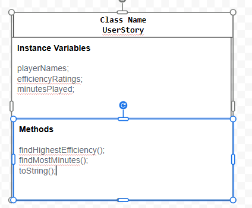

# Unit 2 - Data for Social Good Project

## Introduction

Software engineers develop programs to work with data and provide information to a user. Each user has different needs based on the information they are looking for from data. Your goal is to create a data analysis program for your user that stores and analyzes data to provide the information they need.

## Requirements

Use your knowledge of object-oriented programming, one-dimensional (1D) arrays, and algorithms to create your data analysis program:
- **Write a class** – Write a class to represent your user or business and store and analyze their data with no-argument and parameterized constructors.
- **Create at least two 1D arrays** – Create at least two 1D arrays to store the data that your user needs information about.
- **Write a method** – Write a method that finds or manipulates the elements in a 1D array to provide the information your user needs.
- **Implement a toString() method** – Write a toString() method that returns general information about the data (for example, number of values in the dataset).
- **Document your code** – Use comments to explain the purpose of the methods and code segments and note any preconditions and postconditions.

## User Story 

Include your User Story you analyzed for your project here. Your User Story should have the following format: 

As an NBA fan, I want to find the best NBA player to support so that I can find entertainment and the best overall player. 
## Dataset 

Include a hyperlink to the source of your dataset used for this project. Additionally, provide a short description of each column used from the dataset, and the data type. 
https://www.kaggle.com/datasets/umutalpaydn/nba-20202021-season-player-stats/data 

The player minutes displays how many minutes the player has played in total, the player Efficiency rating shows the positive and negative stats totaled while accounting for the minutes played, and the names of the players. 
Example: 

Dataset: https://www.kaggle.com/datasets/sansuthi/global-co2-emissions 
- **Country** (String) - name of the country 
- **Population** (int) - number of people in the country 
- **CO2Emissions** (double) - carbon dioxide emission in kilotons 

## UML Diagram 

Put an image of your UML Diagram here. Upload the image of your UML Diagram to your repository, then use the Markdown syntax to insert your image here. Make sure your image file name is one work, otherwise it might not properly get displayed on this README. 

 

## Description 

Write a description of your project here. In your description, include as many vocab words from our class to explain your User Story, the chosen dataset and how your project addressed that users goals. If your project used the Scanner class for user input, explain how the user will interact with your project.

Our project analyzes NBA player stats in order to help NBA fans compare which player is the best overall and who they may enjoy watching. Our program uses a FileReader class in order to load the information of the files into three 1D arrays. Our program uses a constructor and initilizes the arrays, for loops to traverse the data, and a toString method to display the player's names and the corresponding info. We used methods to find the player with the highest efficiency rating and the player with the most minutes played. When we organized the data, we made the project easier for NBA fans to compare which player had the best overall performances. The program doesn't use a scanner class becaseu teh data is already stored in text files, so the user doesn't need to enter info but instead can look through the info. 